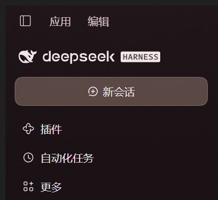

# 樱雾 · Sakura Mist

> 给 DeepSeek Harness Web 界面的一层「粉色护眼材质」：暖玫瑰纸色、低饱和、圆角石子感、纸纹与柔光。
> 朴素、不喧哗；深浅两套色随 DSH 的外观设置自动切换。



> 公开版只保留不含会话内容的局部截图；完整窗口截图仅本地保留在 `preview/raw/`（已 gitignore）。

---

## 0. 现状：已注册为正式 profile bundle

主题已从「手工 insert 行」升级为 **正式 profile bundle**，登记在 profile 清单里：

```jsonc
// ~/.dsh/profiles/desktop/package.json
"dependencies": {
  "dsh-theme-sakura-mist": "link:C:/Users/<you>/.dsh/themes/dsh-theme-sakura-mist"
},
"dsh": { "profile": { "bundles": [ ... , "dsh-theme-sakura-mist" ] } }
```

- 因此它出现在 **设置 → 插件**（Settings → Plugins）的 bundle 列表里，可以像其他插件一样开关；
- 开关走 HMR 热重算，无需重启（实测：从 bundles 列表移除后约 7 秒主题卸载，beacon 变 404；
  加回后 `hostLoadedAt` / `clientAppliedAt` 立即更新、样式恢复）；
- 主题自己的 `cordis.patch.yml` 负责插入 `sakura-mist-theme` 行，profile 的 `cordis.patch.yml`
  不再需要手工 insert 行；
- 源码仍在 `%USERPROFILE%\.dsh\themes\dsh-theme-sakura-mist`，应用升级不会清除。

维护命令（幂等；Windows PowerShell 5.1 / 7 均可）：

```powershell
node "$env:USERPROFILE\.dsh\themes\dsh-theme-sakura-mist\qa\manage.mjs" status     # 查看登记状态
node "...\qa\manage.mjs" install                                                  # 安装 / 修复
node "...\qa\manage.mjs" uninstall                                                # 从 profile 移除（保留源码）
```

等价的 `.ps1` 包装：`qa/install.ps1`、`qa/uninstall.ps1`。
`install` 会依次：构建 bundle → 写 link 依赖 → 创建 node_modules 链接 → 选中 bundle → 触发一次 HMR 重算。

> 历史记录：2026-10-23 的 DSH 自动更新曾把应用从 `0.2.1-rc.2` 升到 `0.2.1-rc.3`，安装目录被整体替换，
> 当时放在 `安装目录（旧位置）` 的源码被清掉；现已迁移到 `~/.dsh/themes` 并按 bundle 方式重装，
> 在 rc.3 上实测生效。


---

## 1. 设计说明

### 四个目标怎么落地

| 要求 | 做法 |
| --- | --- |
| **护眼** | 不用纯白/纯黑：浅色底 `#fbf6f3`（暖玫瑰纸），正文 `#2c201b`（暖墨）；深色底 `#241a1d`（暮樱紫褐），正文 `#f3e8ea`（奶油粉白）。低饱和、去蓝光感。 |
| **朴素** | 粉只用于底色、选中态、用户气泡与强调色（`#ad6277` / `#d48e9f`）；成功/警告/错误、代码高亮保留语义，只做暖化。 |
| **圆角** | 半径整体放大：xs 6 / sm 10 / md 14 / lg 20 / xl 26 / panel 32 px，并强化 `corner-shape: superellipse(1.62)`。 |
| **高级质感** | 暖褐分层阴影 + 发丝描边、菜单雾面磨砂、约 4–5% 极淡 SVG 纸纹与两团柔光。 |

### 两套调色板（核心令牌）

| 角色 | 浅色「暖樱纸」 | 深色「暮樱」 |
| --- | --- | --- |
| 画布 `bg-base` | `#fbf6f3` | `#241a1d` |
| 侧栏 `specific-sidebar-fill` | `#f4e9e3` | `#180f12` |
| 卡片 `bg-layer-1/2/3` | `#fffdfb` / `#fdf7f4` / `#f8f0eb` | `#2b1e23` / `#312227` / `#37272c` |
| 正文 `label-primary` | `#2c201b` | `#f3e8ea` |
| 次要文字 `label-secondary` | `#5f4a42` | `#d8c4c8` |
| 发丝线 `border-l3/l4` | `#7a4f473d` / `#7a4f4740` | `#f6e4e83d` / `#f6e4e83d` |
| 强调 `state-business-primary` | `#ad6277` | `#d48e9f` |
| 用户气泡 `specific-bubble` | `#fbe8eb` | `#3c262e` |
| 菜单 `specific-menu` | `#fcf6f2f0` | `#33242aea` |
| 选区 | `#c97e9673`（45%） | `#d896a666`（40%） |

完整令牌清单见 [`research/tokens.md`](research/tokens.md)。

### 逐轮调整记录

1. **基础材质**：暖化 static 中性色阶（深浅两套别名自动跟随），玫瑰强调、圆角、纸纹、雾面菜单。
2. **区域与选区对比度**：侧栏明显深于画布，侧栏右缘加 1px 暖色分隔线 + 内侧投影（命中 `[class*="_sidebarCol"]`，只画阴影不改布局）；`::selection` 提到 45% / 40% 并固定选中文字主色。
3. **数学公式回退色**：KaTeX 解析失败时框架内联写死 `color:#cc0000`，用 `!important` 覆盖 `.katex-error` 为柔和的灰玫/砖粉：
   - 深色 `#c9918c`，浅色 `#b1746e`（验证脚本 `qa/check-katex.mjs`）。

---

## 2. 实现方式（为什么不改安装包）

主题是一个**第三方客户端插件**，全部视觉在浏览器侧完成：

1. `lib/index.js`（宿主侧）：注册 `/sakura-mist/beacon` 诊断路由，写 `~/.dsh/sakura-mist/applied.json`；
2. `lib/client.js`（浏览器侧）：`window.__ModuleLoader__.load()` 自注册，`apply(ctx)` 时把
   `src/theme.css` 作为 constructable stylesheet 挂到 `document`，给 `<html>` 加 `dsh-sakura-mist` 类；
   卸载时完整回滚；
3. CSS 只覆盖 `--dsw-*` 设计令牌与少量装饰规则，**不碰布局、字号阶梯与组件结构**。

因此可热加载、可热卸载、可回滚；应用升级只需要保留 `~/.dsh` 下的源码与 profile 补丁。

---

## 3. 使用与二次调整

### 改配色 / 改质感

```powershell
cd "$env:USERPROFILE\.dsh\themes\dsh-theme-sakura-mist"
node build.mjs      # 生成 lib/client.js
```

约 1 秒内打开着的 DSH 页面会**热替换**主题（无需刷新、无需重启）。`build.mjs` 无第三方依赖。

### 修复 / 重新安装 / 卸载

```powershell
node qa/manage.mjs status      # 登记状态 + 最近一次生效时间
node qa/manage.mjs install     # 安装或修复（幂等）
node qa/manage.mjs uninstall   # 从 profile 移除（保留源码）
pwsh -File qa/install.ps1      # 等价包装
pwsh -File qa/uninstall.ps1
```

### 静态检查 / 截图验证

```powershell
node --check lib/client.js
node --check lib/index.js
pwsh -File qa/capture-desktop.ps1 -Out preview/raw/desktop.png  # 截取 DSH 窗口（PrintWindow，不抢焦点）
node qa/check-katex.mjs                                    # 公式回退色校验（PASS/FAIL）
```

### 卸载

```powershell
node qa/manage.mjs uninstall
```

从 `dsh.profile.bundles` 取消选择、移除 link 依赖与 node_modules 链接；**不会删除**
`~/.dsh/themes` 下的源码。改动经 HMR 热应用，界面几秒内复原。

---

## 4. 文件结构

```
dsh-theme-sakura-mist/
├─ package.json          # dsh.client 声明 + dsh.bundle.patch（正式 bundle 入口）
├─ cordis.patch.yml      # bundle 自带的 insert 补丁（由 DSH 加载，无需写入 profile patch）
├─ build.mjs             # 零依赖打包：theme.css + client-entry.js → lib/client.js
├─ src/
│  ├─ theme.css          # 材质本体（全部设计令牌、纸纹、区域分隔、选区、公式回退色）
│  └─ client-entry.js    # 浏览器侧插件逻辑（注入样式、回执、回滚）
├─ lib/
│  ├─ index.js           # 宿主侧：beacon 路由 + 状态文件
│  └─ client.js          # 构建产物（DSH 下发的自注册 bundle）
├─ qa/
│  ├─ manage.mjs         # bundle 安装/卸载/状态（依赖 link + bundles 列表 + HMR trigger）
│  ├─ install.ps1        # manage.mjs install 的包装
│  ├─ uninstall.ps1      # manage.mjs uninstall 的包装
│  ├─ capture-desktop.ps1# 截取 DSH 窗口
│  └─ check-katex.mjs    # 公式回退色校验（含 check-katex.html）
├─ preview/              # 实机局部截图（完整截图放在 preview/raw/ 且不提交）
└─ research/
   ├─ tokens.md          # --dsw 设计令牌要点（升级后重写版）
   └─ pipeline.md        # 客户端插件热加载管线要点（升级后重写版）
```

---

## 5. 已知边界

- **原生窗口标题栏**由 Electron 外壳绘制，CSS 无法改色，跟随 DSH 外观设置。
- 少量组件使用写死颜色/内联变量（hovercard、CodeMirror 选中态、xterm 终端、macOS 侧栏渐变），不在令牌体系内，本主题不强行覆盖。
- 纸纹是 `position: fixed` 全屏伪元素（`pointer-events: none`，无混合模式），性能开销很小；如在意可删掉 `theme.css` 第 5 节。
- profile 的 `node_modules` 由 pnpm 管理；如果某次安装把链接 prune 掉，运行 `node qa/manage.mjs install` 恢复。
- 设置 → 插件 的开关等价于直接改 `dsh.profile.bundles`，两者都会触发 HMR 热重算；关掉后主题完全回滚。
- DSH 若大改客户端插件协议（`dsh.client` / `__ModuleLoader__`），需要按新 API 调整 `build.mjs` 与 `lib/index.js`；
  rc.3 已验证仍兼容当前实现。

---

## 6. 许可与声明

- 本仓库的**主题代码**（CSS 覆盖、插件胶水、构建与脚本）以 MIT 许可发布，见 [LICENSE](LICENSE)。
- 这是一个**非官方第三方主题**，与 DeepSeek 官方无隶属或背书关系；DeepSeek Harness 是独立的开源项目，本仓库不分发其代码或资源。
- `research/` 里的令牌名、色值与加载管线记录，是为插件互操作性整理的事实性笔记，不是 DSH 源码的副本。
- 界面截图中的 UI 组件版权归 DeepSeek；截图仅用于展示主题效果。
- “DeepSeek”“Harness”等商标归其各自所有者。若准备在官方社区发布，请先确认项目的品牌与分发规范。

## 7. 发布到 GitHub

仓库已 `git init` 并暂存全部可公开文件（`preview/raw/` 中含会话内容的截图已被 `.gitignore` 排除）。发布步骤：

```powershell
cd "$env:USERPROFILE\.dsh\themes\dsh-theme-sakura-mist"
git config user.name  "你的名字"
git config user.email "you@example.com"
git commit -m "feat: Sakura Mist - pink eye-friendly theme for DeepSeek Harness"

# 在 GitHub 新建空仓库（不要勾选 README/.gitignore/LICENSE），然后：
git remote add origin git@github.com:<you>/dsh-theme-sakura-mist.git
git push -u origin main
```

推送前可再看一眼暂存内容：`git status --short`、`git diff --cached --stat`。
若想把主题登记到 DSH 插件市场/社区列表，需按该市场的投稿规范另行提交（通常要求仓库公开、带 `dsh` 关键字、且 `lib/client.js` 已构建）。
